# membench-aml



`membench-aml` is a notebook-first Azure SDK walkthrough for running MemoryBench experiments in Azure Machine Learning.

It lets collaborators run a cell-by-cell workflow to:

- fetch benchmark source files from HTTP/GitHub/HuggingFace-style locations;
- prepare sampled benchmark-set folders;
- register those benchmark sets as Azure ML data assets;
- submit AML benchmark jobs from notebook settings;
- monitor jobs and aggregate answer-correctness metrics from AML artifacts.

The notebook currently supports three built-in dataset choices: `longmemeval`, `locomo`, and `statebench`.

## Requirements

- Python 3.11+
- Azure CLI 2.83.0 or newer
- Azure CLI login with `az login`
- Permission to create resources in an Azure subscription
- Permission to assign RBAC roles, or an admin who can grant the roles printed by the infra script

## Setup

```powershell
cd C:\path\to\membench-aml
python -m venv .venv
.\.venv\Scripts\python.exe -m pip install -r requirements.txt
az version
```

Create the Azure runtime environment and generate `.env`:

```powershell
az login
az upgrade
.\infra\setup.ps1 -EnvironmentName memorybench -Location eastus2
```

The infra script creates/configures Azure ML, AML compute, Azure AI Services, a Foundry project, the AML job managed identity, and RBAC. It writes the generated values to `.env`.

Then deploy or select your model deployments in the generated AI Services resource and fill these three values in `.env`:

```powershell
ANSWER_DEPLOYMENT=<answer-or-agent-model-deployment>
JUDGE_DEPLOYMENT=<judge-model-deployment>
EMBEDDING_DEPLOYMENT=<embedding-model-deployment>
```

Commands automatically load `.env` from the current working directory. Values in `.env` take precedence when rerunning notebook cells.

Most users can use one answer/agent deployment for the benchmarked model, plus a separate judge deployment for evaluation. The notebook reuses those same deployments for STATE-Bench.

## Workflow: notebook walkthrough

Open:

```text
notebooks\memorybench_aml_workflow.ipynb
```

The notebook is intentionally self-contained: the cells use Azure SDKs directly and include the workflow code inline. It is meant to read like a Microsoft Docs walkthrough.

It uses `.env` settings and runs the flow cell by cell:

```text
load .env settings -> preflight Azure -> fetch data -> prepare data -> register data -> dry-run/submit AML jobs -> stream jobs -> aggregate results
```

The wait step uses the Azure ML SDK's built-in `ml_client.jobs.stream(job_name)` call, so the SDK streams each AML job until it finishes.

The repo includes `runner\benchmark-runner`, which is the AML runtime code submitted for LongMemEval and LoCoMo jobs. Users should not need to edit it; the notebook submits it to Azure ML.

The dataset selection lives in `.env`:

```text
DATASET=longmemeval
DATASET_PERCENT=1
```

Built-in dataset presets:

| `DATASET` | Source | Notebook support |
|---|---|---|
| `longmemeval` | `xiaowu0162/LongMemEval`, Hugging Face `xiaowu0162/longmemeval-cleaned` | End-to-end supported: fetch, prepare, register, submit, aggregate. |
| `locomo` | `snap-research/locomo`, `data/locomo10.json` | QA data is adapted into the same MemoryBench QA format, then can be registered/submitted through the notebook. |
| `statebench` | `microsoft/STATE-Bench` | Agent-learning train trajectories are prepared and submitted through STATE-Bench's official `run_batch` runner, followed by `compute_metrics`. |

LongMemEval and LoCoMo use the MemoryBench QA runner and require `AZURE_AI_PROJECT_ENDPOINT`, `AZURE_OPENAI_ENDPOINT`, `ANSWER_DEPLOYMENT`, `JUDGE_DEPLOYMENT`, `EMBEDDING_DEPLOYMENT`, and `MEMORY_STORE_NAME`. STATE-Bench benchmark runs use the separate official STATE-Bench path below.

`MEMORY_STORE_NAME` is a store name, not a pre-created resource requirement. The QA runner checks the Foundry project and creates the memory store automatically if it does not already exist.

The notebook registers a reusable Azure ML environment named `memorybench-runner`. That environment uses Python 3.12 because the pinned STATE-Bench dependency requires it. It contains the Azure SDK runtime dependencies and the pinned STATE-Bench dependency, so AML jobs do not run `pip install` or `git clone` during every job.

Reference docs:

- LongMemEval: https://github.com/xiaowu0162/LongMemEval
- LoCoMo: https://github.com/snap-research/locomo
- STATE-Bench: https://github.com/microsoft/STATE-Bench/blob/main/docs/RUN_BENCHMARK.md

The notebook derives source URL, local paths, AML asset name, number of cases, and shard count from `DATASET` and `DATASET_PERCENT`.

The notebook uses the built-in source associated with `DATASET`.

The notebook derives the AML data asset reference automatically:

```text
azureml:<derived-dataset-name>:1
```

Set `DATASET_VERSION` in `.env` when you intentionally want a new immutable Azure ML data asset version for the same dataset name. Set `AML_ENVIRONMENT_VERSION` if you intentionally change the AML environment definition and need a new environment version.

The notebook supports LongMemEval end to end, adapts LoCoMo QA into the MemoryBench QA runner format, and uses STATE-Bench's official `state_bench.scripts.run_batch` path for STATE-Bench tasks.

For STATE-Bench, the notebook clones the official repo once into ignored local folder `external\STATE-Bench` and reuses that checkout for future runs. The AML job receives that prepared checkout as its code snapshot; it does not clone STATE-Bench during job execution.

For private/gated datasets, download the source file yourself into the default local path shown by the notebook, skip the fetch cell, and continue from the prepare-data cell.

## How the run actually works

The same two `.env` settings choose the benchmark and amount of data:

```text
DATASET=longmemeval
DATASET_PERCENT=1
```

The notebook derives source URL, local paths, AML data asset name, selected case count, and AML job count from those values.

For LongMemEval and LoCoMo, each selected item is a **memory QA case**. For STATE-Bench, each selected item is an **agent task**.

| Concept | Meaning |
|---|---|
| **Case/task** | One complete benchmark item. LongMemEval/LoCoMo use QA cases; STATE-Bench uses agent tasks. |
| **Sample** | The percentage of the selected dataset to run. |
| **Shard** | One AML job that processes a subset of complete cases. Shards parallelize cases; they do not split a single case's timeline. |

Each case/task remains self-contained. The notebook never cuts one case's transcript or one STATE-Bench task across different AML jobs.

### LongMemEval and LoCoMo QA conditions

For each LongMemEval/LoCoMo QA case, the MemoryBench QA runner evaluates these answer conditions:

| Condition | What the model sees | Why it exists |
|---|---|---|
| `question-only` | Only the question. No transcript, memory, or supporting context. | Baseline for what the model can guess without memory. |
| `full-transcript` | The full normalized transcript/history for that case. | Tests whether the answer model can answer if given all case context directly. |
| `oracle-context` | Only the benchmark-provided answer/supporting sessions. | Best-case evidence baseline: if the model is handed the right sessions, can it answer? |
| `foundry-memory` | Foundry Memory ingests the case history, searches memory with the question, then the model answers from retrieved memories. | Tests the memory system: ingestion, extraction, retrieval, and answer use. |

For Foundry Memory, `k` is the retrieval budget. For example, `maxMemories: 32` means the answer step can receive up to 32 retrieved memories. It does not mean 32 memories are stored.

Use the conditions diagnostically:

| Pattern | Likely interpretation |
|---|---|
| `oracle-context` fails | The answer model/prompt/scoring may be the issue, because even the known supporting sessions were supplied. |
| `oracle-context` succeeds but `foundry-memory` fails | Memory ingestion, extraction, retrieval, or stale/conflicting memories are likely the issue. |
| `full-transcript` succeeds but `foundry-memory` fails | The information exists in the case history, but memory did not surface it correctly. |
| `question-only` succeeds | The question may be guessable or answerable from model priors, so treat memory lift carefully. |

`full-transcript` can be large. The runner logs transcript session count, character count, and rough token estimate in full-transcript case outputs so context-window issues can be diagnosed.

### STATE-Bench metrics

STATE-Bench does not produce QA case blobs. It uses the official STATE-Bench runner and reports metrics such as:

| Metric | Meaning |
|---|---|
| `task_completion_pass@1` | Fraction of selected tasks completed successfully. |
| `task_completion_pass^1` | Fraction of tasks that passed all runs; with one run this matches pass@1. |
| `mean_ux_score` | Judge-rated conversation quality on a 1–5 scale. |
| `mean_cost_usd` | Average agent cost when pricing is configured. |

### Judge and model setup for MemoryBench QA

The runner uses the official LongMemEval `evaluate_qa.py` judge wording, with a newer judge deployment:

| Piece | Current setting |
|---|---|
| Answer deployment | `ANSWER_DEPLOYMENT` |
| Judge deployment | `JUDGE_DEPLOYMENT` |
| Judge prompt | `longmemeval-official-evaluate-qa` |

The judge prompt follows the official LongMemEval question-type rules, including temporal off-by-one tolerance, preference rubric handling, knowledge-update handling, and abstention handling.

The answer prompts are MemoryBench/Foundry prompts because LongMemEval and LoCoMo evaluate submitted hypotheses; they do not require one universal answer prompt for every memory system.

### What the default notebook settings run

Current dataset defaults:

```text
DATASET=longmemeval
DATASET_PERCENT=1
```

The notebook uses these fixed defaults:

```text
MAX_MEMORIES=8
memory reuse on
```

If your source file has 100 cases, `DATASET_PERCENT=1` prepares **1 complete case**. The notebook derives AML jobs automatically: **1 AML job per 5 selected items**.

Memory reuse means the normal and structured memory prompts use the same ingested/retrieved memories. That keeps prompt comparisons clean and avoids re-ingesting the same transcript just to change answer formatting.

Foundry Memory is a live service. Separate ingestions of the same transcript into separate scopes may produce different extracted memories. Treat repeatability-sensitive results accordingly, and prefer repeated runs or fixed/cached memory outputs for strong claims.

### How results are combined for LongMemEval and LoCoMo

Each AML job writes per-case JSON blobs to AML storage, for example:

```text
outputs/cases/question-only-<case-id>.json
outputs/cases/full-transcript-<case-id>.json
outputs/cases/oracle-context-<case-id>.json
outputs/cases/foundry-memory-<case-id>.json
outputs/cases/foundry-memory-structured-<case-id>.json
```

After jobs complete, run the aggregation cell. For LongMemEval and LoCoMo, aggregation uses the submitted jobs from the same notebook session, downloads all case blobs, groups them by condition, and recomputes answer-correct / total.

For STATE-Bench, the result cell reads `outputs/statebench/<domain>/metrics.json` from the AML job artifacts.

## Outputs

This emits:

- full aggregate JSON;
- focused `*-primary-metrics.json` containing answer-correctness metrics.

The primary metrics are intentionally small:

```json
{
  "answer_correct": 3,
  "answer_total": 5,
  "answer_accuracy": 0.6,
  "answer_percent_correct": 60.0,
  "structured_answer_percent_correct": 60.0,
  "baseline_percent_correct": 0.0,
  "full_transcript_percent_correct": 80.0,
  "selected_transcript_percent_correct": 80.0,
  "oracle_context_percent_correct": 60.0,
  "memory_lift_pp": 60.0
}
```

## Proven smoke

The notebook path has been proven from a local `.venv`:

```text
preflight: passed
longmemeval: one-case AML job completed with QA case blobs and metrics
locomo: one-case AML job completed with QA case blobs and metrics
statebench: one-task AML job completed with STATE-Bench metrics.json
```

These are smoke tests, not benchmark claims. The end-to-end flow worked:

```text
prepare/register dataset -> submit AML job from notebook settings -> run in AML -> read result artifacts
```

## Benchmark-faithfulness notes

- Development samples such as 10% or one-case runs are not official benchmark results.
- LongMemEval official-style runs should ingest full haystack history.
- Shortcuts such as answer-aware session selection must be labeled as diagnostics, not official results.
- `k` means the number of retrieved memories passed to the reader, not the number of stored memories.
- Keep raw denominators visible; clean-case metrics are diagnostics.
- `oracle-context` is a diagnostic upper-bound condition, not a memory-system result.
- Prompt comparisons should reuse the same ingested/retrieved memories; separate ingestions are only useful for repeatability testing.

## License

Project code is licensed under the [MIT License](LICENSE). LongMemEval-derived judge prompts retain their upstream MIT notice in [THIRD_PARTY_NOTICES](THIRD_PARTY_NOTICES).

Downloaded datasets and third-party dependencies remain subject to their own licenses and terms; this project's license does not relicense them.
